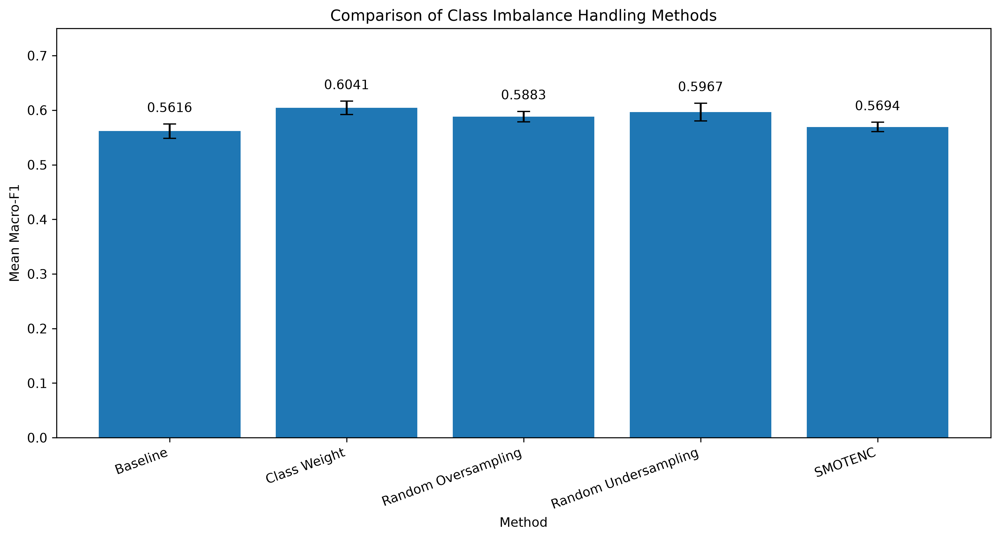
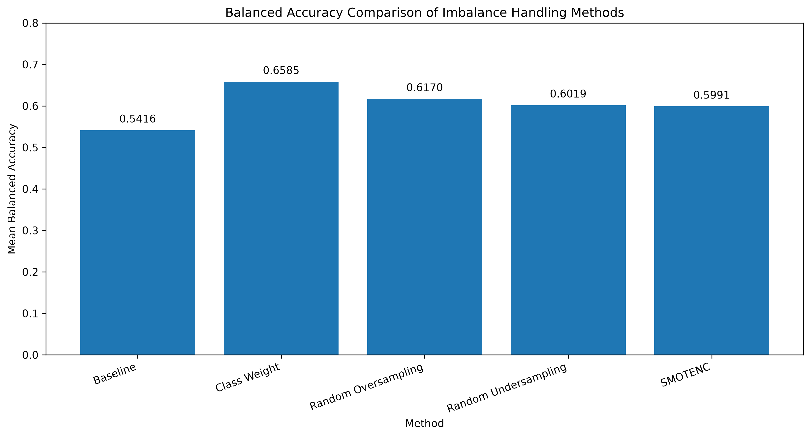
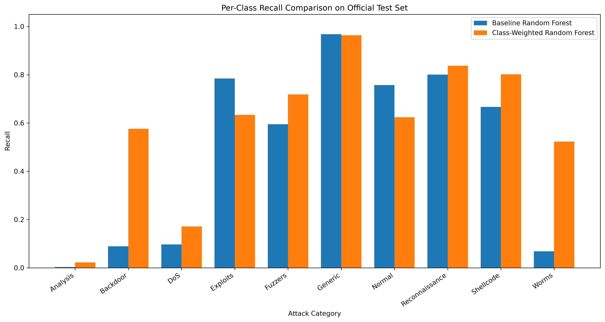

# Machine Learning-Based Network Intrusion Detection under Class Imbalance

## 1. Project Overview

This project investigates the impact of class imbalance on machine learning-based network intrusion detection using the UNSW-NB15 dataset.

The study focuses on multiclass classification involving normal network traffic and nine attack categories. It evaluates how different imbalance-handling techniques affect the detection of minority attack classes, particularly Worms, Backdoor, Shellcode, and Analysis.

Logistic Regression and Random Forest are used as baseline models. Several imbalance-handling methods are investigated, including class weighting, random oversampling, random undersampling, and SMOTENC.

## 2. Research Question

**How do different class imbalance-handling techniques affect the detection performance of minority attack categories in machine learning-based network intrusion detection?**

The project evaluates overall classification performance alongside class-specific precision, recall, and F1-score, with particular attention to the trade-off between minority-class detection and false positives.

## 3. Dataset

This project uses the UNSW-NB15 dataset, developed by the University of New South Wales (UNSW Canberra), for network intrusion detection research.

The dataset contains normal network traffic and nine attack categories:

- Analysis
- Backdoor
- DoS
- Exploits
- Fuzzers
- Generic
- Reconnaissance
- Shellcode
- Worms

### 3.1 Dataset Statistics

The official training and testing partitions are used:

| Dataset | Samples | Features |
|---------|---------|----------|
| Training Set | 175,341 | 42 |
| Testing Set | 82,332 | 42 |

The dataset contains 45 columns, including an ID column, 42 input features, and two target labels.

Three categorical input features (`proto`, `service`, and `state`) are encoded using One-Hot Encoding. Numerical features are processed using a standard preprocessing pipeline.

### 3.2 Class Imbalance

The dataset exhibits substantial class imbalance.

For example, the training set contains 56,000 Normal samples but only 130 Worms samples.

This imbalance motivates the investigation of techniques designed to improve minority-class detection.

### 3.3 Data Source

The dataset is publicly available from the official UNSW-NB15 project page:

https://research.unsw.edu.au/projects/unsw-nb15-dataset

The original dataset files are not included in this repository. Users should download the official training and testing CSV files and place them in the `data/raw/` directory.

## 4. Methodology

### 4.1 Data Preprocessing

The preprocessing pipeline consists of:

- Removing the `id`, `label`, and `attack_cat` columns from the input features.
- Applying median imputation and StandardScaler to numerical features.
- Applying categorical imputation and One-Hot Encoding to categorical features.
- Fitting preprocessing transformations exclusively on training data to reduce data leakage risks.

All preprocessing operations are integrated into machine learning pipelines to support reproducibility.

### 4.2 Baseline Models

Two machine learning algorithms are used to establish baseline performance:

- Logistic Regression
- Random Forest

A binary Logistic Regression model is first trained to distinguish normal traffic from attack traffic.

Multiclass Logistic Regression and Random Forest models are then trained to classify normal traffic and nine attack categories.

The Random Forest models use 100 estimators with a fixed random seed of 42.

### 4.3 Class Imbalance Handling

Four imbalance-handling techniques are evaluated against an unweighted Random Forest baseline:

1. Class Weighting: Assigning class weights inversely proportional to class frequencies.
2. Random Oversampling: Increasing minority-class representation through random sampling with replacement.
3. Random Undersampling: Reducing selected majority-class sample counts.
4. SMOTENC: Generating synthetic minority-class samples while accounting for categorical and numerical features.

Resampling operations are performed exclusively within the training portion of each experiment.

### 4.4 Cross-Validation

Five-fold Stratified Group Cross-Validation is used to evaluate the robustness of the experimental results.

Samples with identical input feature patterns are assigned to the same group to prevent identical feature patterns from appearing in both training and validation subsets within a fold.

Model performance is evaluated using:

- Accuracy
- Macro-F1 Score
- Balanced Accuracy
- Per-class Precision
- Per-class Recall
- Per-class F1-score

Macro-F1 and Balanced Accuracy are prioritised because overall accuracy alone can obscure poor performance on minority attack categories.

### 4.5 Final Evaluation and Data Reliability

The official UNSW-NB15 training partition is used for model development and cross-validation.

The class-weighted Random Forest is selected as the final candidate based on its cross-validation performance.

The selected model is retrained using the complete official training partition and evaluated on the official test partition.

Additional data quality investigations include:

- Missing-value and duplicate-record analysis.
- Identification of identical feature patterns with conflicting class labels.
- Detection of feature-pattern overlap between the official training and testing partitions.
- Performance comparison between the complete official test set and a non-overlapping test subset.

These analyses help identify potential evaluation biases and limitations associated with duplicated and conflicting feature patterns.

## 5. Experimental Results

### 5.1 Cross-Validation Results

Five-fold Stratified Group Cross-Validation was conducted to compare the unweighted Random Forest baseline with four class imbalance-handling techniques.

| Method | Mean Macro-F1 | Mean Balanced Accuracy |
|--------|---------------|------------------------|
| Baseline Random Forest | 0.5616 | 0.5416 |
| Class Weight | **0.6041** | **0.6585** |
| Random Oversampling | 0.5883 | 0.6170 |
| Random Undersampling | 0.5967 | 0.6019 |
| SMOTENC | 0.5694 | 0.5991 |

Class Weight achieved the highest mean Macro-F1 and Balanced Accuracy among the evaluated methods.

Compared with the unweighted Random Forest, class weighting increased mean Macro-F1 by 0.0425 and mean Balanced Accuracy by 0.1169.

However, these results represent performance on the UNSW-NB15 training partition under grouped cross-validation and should not be interpreted as final test performance.

### 5.2 Official Test Set Results

The selected class-weighted Random Forest was retrained on the complete official training partition and evaluated on the official test set.

| Metric | Baseline RF | Class-Weighted RF |
|--------|-------------|-------------------|
| Accuracy | 0.7544 | 0.6921 |
| Macro-F1 | 0.4585 | 0.5010 |
| Balanced Accuracy | 0.4828 | 0.5871 |

Class weighting improved Macro-F1 and Balanced Accuracy but reduced overall classification accuracy.

This demonstrates a trade-off between average class-level detection performance and overall prediction accuracy.

### 5.3 Minority-Class Detection

Class weighting substantially improved recall for several minority attack categories on the official test set.

| Attack Category | Baseline Recall | Weighted Recall |
|-----------------|-----------------|-----------------|
| Backdoor | 0.0892 | 0.5763 |
| Shellcode | 0.6667 | 0.8016 |
| Worms | 0.0682 | 0.5227 |

Despite these improvements, substantial false-positive problems remained.

For example, the class-weighted model achieved approximately 57.63% recall for Backdoor but only 5.02% precision.

Furthermore, improvements were not consistent across all classes. The recall of Normal and Exploits decreased after class weighting.

These findings suggest that class imbalance handling must be evaluated using both recall and precision, rather than minority-class recall alone.

### 5.4 Data Reliability and Sensitivity Analysis

Data quality analysis identified repeated feature patterns and conflicting class labels within the training data.

Additionally, 8,541 official test records (10.37%) had input feature patterns identical to at least one training record.

To investigate the sensitivity of model performance to this overlap, the final model was evaluated on both the complete official test set and a non-overlapping test subset.

| Evaluation Set | Samples | Accuracy | Macro-F1 | Balanced Accuracy |
|----------------|---------|----------|----------|-------------------|
| Official Test Set | 82,332 | 0.6921 | 0.5010 | 0.5871 |
| Non-overlapping Test Subset | 73,791 | 0.7242 | 0.5328 | 0.6208 |

All three evaluation metrics increased on the non-overlapping subset.

However, removing overlapping records also changes the composition and class distribution of the evaluation data. Therefore, the observed differences should not be interpreted as causal evidence that overlapping records reduce model performance.

The non-overlapping subset is reported as a supplementary sensitivity analysis rather than a replacement for the official test partition.

### 5.5 Summary of Findings

The experimental results suggest that:

1. Class imbalance is associated with substantial differences in detection performance across attack categories.
2. Class weighting achieved the strongest average performance among the evaluated approaches under five-fold grouped cross-validation.
3. Improved minority-class recall can come at the cost of reduced precision and increased false positives.
4. Performance improvements observed during cross-validation do not necessarily transfer at the same magnitude to the official test partition.
5. Repeated feature patterns, conflicting labels, and train-test feature overlap are important considerations when interpreting intrusion detection results.

These findings highlight the importance of evaluating machine learning-based intrusion detection systems using class-sensitive metrics and transparent experimental protocols.

## 6. Project Structure and Reproducibility

### 6.1 Project Structure

The project is organised as follows:

    m1-nids-class-imbalance/
    |
    |-- data/
    |   |-- raw/
    |   |-- processed/
    |
    |-- notebooks/
    |   |-- 01_data_understanding.ipynb
    |   |-- 02_binary_baseline.ipynb
    |   |-- 03_multiclass_baseline.ipynb
    |   |-- 04_imbalance_experiments.ipynb
    |   |-- 05_results_analysis.ipynb
    |
    |-- results/
    |   |-- figures/
    |   |-- tables/
    |
    |-- src/
    |-- report/
    |
    |-- README.md
    |-- requirements.txt
    |-- .gitignore

The Jupyter Notebooks document the experimental workflow, from initial data exploration to model evaluation and error analysis.

The results/figures/ directory contains experimental visualisations, while results/tables/ contains numerical evaluation results.

### 6.2 Environment Setup

The experiments were developed using Python 3.11 and scikit-learn.

Create a virtual environment in the project directory:

    python -m venv .venv

Activate the environment on Windows:

    .\.venv\Scripts\Activate.ps1

Install the required dependencies:

    python -m pip install -r requirements.txt

The project uses pandas, NumPy, scikit-learn, imbalanced-learn, Matplotlib, and Jupyter.

### 6.3 Dataset Preparation

Download the UNSW-NB15 training and testing datasets from the official source:

https://research.unsw.edu.au/projects/unsw-nb15-dataset

Place the following files inside data/raw/:

    UNSW_NB15_training-set.csv
    UNSW_NB15_testing-set.csv

The dataset files are excluded from Git version control.

### 6.4 Experiment Reproduction

The notebooks should be executed in the following order:

1. 01_data_understanding.ipynb - Dataset exploration and data quality analysis.

2. 02_binary_baseline.ipynb - Binary Logistic Regression baseline.

3. 03_multiclass_baseline.ipynb - Multiclass Logistic Regression and Random Forest baselines.

4. 04_imbalance_experiments.ipynb - Class imbalance experiments and grouped cross-validation.

5. 05_results_analysis.ipynb - Final evaluation, sensitivity analysis, visualisation, and error analysis.

Select the project virtual environment as the Jupyter kernel before execution.

Within each notebook, execute cells sequentially because later cells may depend on variables created by earlier cells.

### 6.5 Reproducibility Considerations

A fixed random seed of 42 is used for the main stochastic modelling and sampling procedures.

Preprocessing and resampling operations are incorporated into machine learning pipelines to prevent fitting transformations or resampling procedures on validation data.

Five-fold Stratified Group Cross-Validation is used to prevent identical feature patterns from appearing in both training and validation subsets within the same fold.

Model selection among imbalance-handling methods was primarily based on grouped cross-validation within the official training partition.

However, the official test set was also examined during earlier baseline experiments. This prior inspection is acknowledged as a limitation when interpreting the final test results.

A supplementary non-overlapping test subset is used to examine the sensitivity of the final evaluation to repeated feature patterns.

The dependency versions are recorded in requirements.txt. However, exact results may vary across software versions, computing environments, and parallel execution settings.

### 6.6 Experimental Outputs

The main experimental outputs include:

- Classification reports containing per-class precision, recall, and F1-score.
- Confusion matrices for baseline and class-weighted models.
- Cross-validation performance comparisons.
- Minority-class recall analysis.
- False-positive and misclassification analysis.
- Official test and non-overlapping test evaluation results.

Numerical results are saved as CSV files, and figures are exported as high-resolution PNG images.

## 7. Limitations

Although the experiments demonstrate improvements in minority-class detection, several limitations should be considered.

### 7.1 Dataset Limitations

The experiments use only the UNSW-NB15 dataset. Consequently, the findings may not generalise to other intrusion detection datasets or real-world network environments.

The dataset also contains duplicated feature patterns and instances where identical input features correspond to different attack labels. These characteristics may affect classification performance and complicate the interpretation of model errors.

### 7.2 Limited Minority-Class Samples

Some attack categories contain very few samples.

For example, the official training partition contains only 130 Worms samples, while the official test partition contains 44.

Performance estimates for these minority categories may therefore be sensitive to small changes in the number of correctly classified samples.

### 7.3 Evaluation Limitations

Although grouped cross-validation prevents identical feature patterns from appearing in both training and validation subsets within each fold, it does not eliminate every possible source of data dependence.

Furthermore, the official training and testing partitions contain overlapping input feature patterns.

A supplementary non-overlapping test evaluation was conducted to investigate this issue. However, differences between the two evaluation sets may also reflect changes in class distributions.

### 7.4 Precision-Recall Trade-offs

Class weighting improved recall for several minority attack categories but also introduced substantial false positives.

For example, Backdoor recall increased substantially, while its precision remained very low.

Therefore, improving minority-class recall alone does not necessarily produce a more reliable intrusion detection system.

### 7.5 Experimental Scope

The study evaluates Logistic Regression and Random Forest baseline models, with imbalance-handling comparisons focused on Random Forest.

The experiments do not include extensive hyperparameter optimisation, probability calibration, or deployment-based evaluation.

The reported cross-validation results should be interpreted as empirical comparisons within the selected experimental configuration rather than definitive evidence of a universally optimal method.

## 8. Future Work

Future research could extend this study in several directions:

1. Evaluate additional intrusion detection datasets to investigate cross-dataset generalisation.

2. Explore advanced machine learning approaches, including gradient-boosted trees and neural network-based classifiers.

3. Investigate class-specific decision thresholds and probability calibration to improve precision-recall trade-offs.

4. Evaluate hybrid imbalance-handling approaches combining sampling strategies and class weighting.

5. Conduct repeated grouped cross-validation and uncertainty analysis to assess the stability of minority-class performance.

6. Investigate feature selection and feature importance to better understand the network characteristics associated with different attack categories.

7. Explore more realistic evaluation protocols that account for temporal dependencies, network environments, and previously unseen attack behaviour.

## 9. References

[1] Moustafa, N., & Slay, J. (2015). UNSW-NB15: A comprehensive data set for network intrusion detection systems (UNSW-NB15 network data set). 2015 Military Communications and Information Systems Conference (MilCIS), 1-6.

https://doi.org/10.1109/MilCIS.2015.7348942

[2] Chawla, N. V., Bowyer, K. W., Hall, L. O., & Kegelmeyer, W. P. (2002). SMOTE: Synthetic Minority Over-sampling Technique. Journal of Artificial Intelligence Research, 16, 321-357.

https://doi.org/10.1613/jair.953

[3] Pedregosa, F., et al. (2011). Scikit-learn: Machine Learning in Python. Journal of Machine Learning Research, 12, 2825–2830.

https://jmlr.org/papers/v12/pedregosa11a.html

[4] Imbalanced-learn Developers. Imbalanced-learn Documentation.

https://imbalanced-learn.org/stable/

[5] UNSW Canberra. UNSW-NB15 Dataset.

https://research.unsw.edu.au/projects/unsw-nb15-dataset